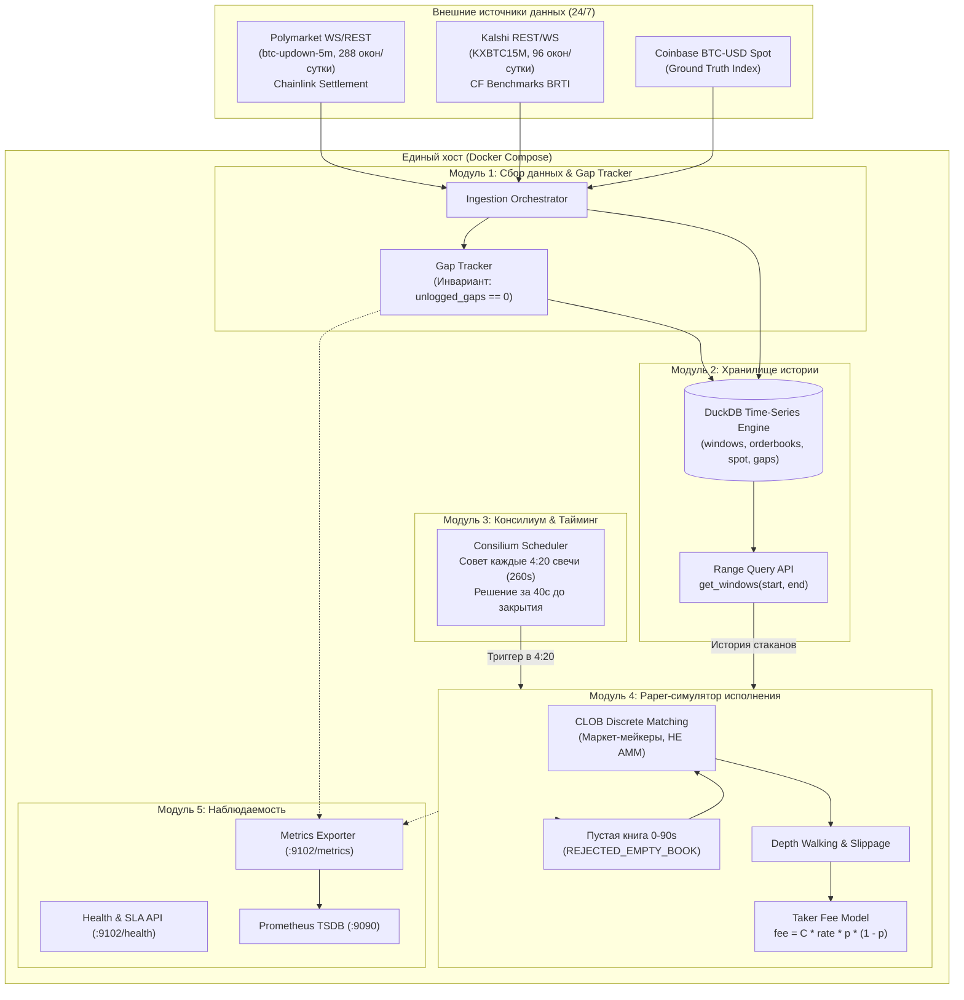

# ⚡ BTC 5-Minute Prediction Markets — Phase 0

> **Phase 0: Architecture + 24/7 Ingestion + CLOB Paper Simulator + Observability**  
> **Source of Truth:** Plane, project `Mindrock`, work item `seq 136` (id `6338becc-f29d-4cf8-bf60-18e95bbd302c`)  
> **Author / Executor:** Antigravity / D007 (Lead Author)  
> **QA Target:** Codex / Muse  
> **Staging & CI:** Vova  
> **Capital:** $0 (Paper Only — Strict Safety Guarantee)  
> **Tier:** VP

---

## 🗺️ 1. Архитектура системы (System Architecture)

Система развёртывается на **одном хосте** через **Docker Compose** (без Kubernetes и enterprise-оверхеда):



---

## 🧩 2. Модули и потоки данных

### Модуль 1: Сбор данных 24/7 (`btc5m/ingestion/`)
- **Polymarket BTC 5-мин (`btc-updown-5m`)**: 288 окон в сутки ($288 \times 300\text{с} = 86400\text{с}$). Сеттлмент по Chainlink BTC/USD.
- **Kalshi 15-мин (`KXBTC15M`)**: 96 окон в сутки ($96 \times 900\text{с} = 86400\text{с}$). Зеркало, сеттлмент по CF Benchmarks BRTI.
- **Индекс BTC/USD**: Ground truth спотовый поток (Coinbase / Chainlink feed) для валидации цен исполнения.
- **Gap Tracker**: непрерывный контроль сетки окон. Если окно пропущено из-за сбоя сети, лимитов API или пула, создаётся запись `WindowGap` с фиксированной причиной (`MARKET_NOT_FOUND`, `UPSTREAM_DISCONNECT`, `API_RATE_LIMIT`).
- **Инвариант качества**: `unlogged_gaps == 0`.

### Модуль 2: Хранилище истории (`btc5m/storage/`)
- Быстрое аналитическое хранилище на базе **DuckDB**:
  - `windows`: метаданные каждого окна (strike, settlement, outcome UP/DOWN, status).
  - `orderbooks`: полные снимки стаканов (bids, asks, spread).
  - `spot_ticks`: тики спотового индекса BTC/USD.
  - `window_gaps`: криминалистический журнал пропусков.
- Полный интерфейс диапазонных запросов: `get_windows(start_time, end_time, venue)`.

### Модуль 3: Консилиум & Тайминг свечи (`btc5m/consilium/`)
- Длительность свечи: **5 минут (300 секунд)**.
- **Совет консилиума: каждые 4:20 свечи ($t = 260\text{ секунд}$)**.
- **Решение: ровно за 40 секунд до закрытия** ($300 - 260 = 40\text{ секунд}$).
- Консилиум агрегирует накопленную историю книги и спота за первые 260 секунд, принимает решение и передаёт paper-ордер на исполнение.

### Модуль 4: CLOB Paper-симулятор (`btc5m/simulator/`)
- **Маркет-мейкеры и форма книги, НЕ AMM**:
  - На CLOB нет формул $x \cdot y = k$ или кривых ликвидности AMM.
  - Моделируются дискретные уровни лимитных заявок маркет-мейкеров (Best Bid, Best Ask, глубина).
- **Пустая книга в первые 1–2 минуты окна**:
  - В первые 60–90 секунд окна маркет-мейкеры ещё не выставили котировки.
  - Попытка отправить сделку в пустую книгу возвращает отказ `REJECTED_EMPTY_BOOK` (0 сделок, 0 списаний).
- **Реалистичный расчет комиссии тейкера**:
  $$\text{fee} = C \times \text{rate} \times p \times (1 - p)$$
  - Polymarket US: $\text{rate} \in [0.0695, 0.095]$ (по умолчанию $0.075$).
  - Kalshi: $\text{rate} = 0.07$.
  - Множитель $C = 1.0$.
  - Комиссия максимальна при $p=0.5$ (максимальная неопределённость бинарного опциона) и спадает к нулю при $p \to 0$ и $p \to 1$.
- **Латентность и проскальзывание**:
  - Задержка исполнения $t_{lat} \sim 80\text{мс}$.
  - Обход книги (depth walking) для расчёта средневзвешенной цены (VWAP) и проскальзывания.
  - Расчёт P&L **net комиссий**: $\text{Net PnL} = \text{Payout} - (\text{Price} \times \text{Size} + \text{Fee})$.

### Модуль 5: Наблюдаемость (`btc5m/observability/`)
- Метрики Prometheus на `:9102/metrics`.
- Health-чек и JSON-статус на `:9102/health`.
- Непрерывный мониторинг выполнения SLA по сбору (проверка 7 суток без незалогированных пропусков).

---

## 🔒 3. Абсолютный запрет Live-пути (Safety Guarantee)

В соответствии с требованиями и Чартером песочницы:
1. Флаг `LIVE_MODE` **выключен по умолчанию** (`LIVE_MODE = False`).
2. В коде **полностью отсутствуют вызовы размещения реальных ордеров** (нет POST-запросов к `/order`, `/orders`, нет модулей подписи EIP-712 / RSA).
3. При любой попытке активировать флаг `LIVE_MODE=True` срабатывает защитный барьер `assert_paper_only()`, выбрасывающий фатальное исключение `RuntimeError`.
4. Статический AST-аудитор `scripts/verify_no_live.py` гарантирует отсутствие утечек и путей размещения ордеров.

---

## 🚀 4. Инструкция по запуску и проверке

### Быстрый запуск воспроизводимой верификации:
```powershell
# Активация виртуального окружения
.\.venv\Scripts\activate

# Запуск полного мастер-сьюта проверок (Acceptance Suite)
python scripts/verify_all.py
```

### Запуск unit- и интеграционных тестов:
```powershell
python -m pytest -v
```

### Запуск симулятора на исторических окнах:
```powershell
python scripts/run_paper_sim.py
```

### Запуск в Docker Compose:
```bash
docker compose up -d
```

---

## 📋 5. Чек-лист Acceptance-критериев Фазы 0

| Критерий | Статус | Доказательство |
| :--- | :---: | :--- |
| **Сбор 24/7 (288 PM + 96 Kalshi в сутки)** | ✅ **ВЫПОЛНЕНО** | `GapTracker` ведет учет окон, проверяет 7-дневную непрерывность, незалогированных пропусков — **0**. |
| **История доступна по диапазону** | ✅ **ВЫПОЛНЕНО** | `StorageRepository.get_windows(start, end)` возвращает полный упорядоченный список окон. |
| **Paper-симулятор с чистым P&L net комиссий** | ✅ **ВЫПОЛНЕНО** | Формула $\text{fee} = C \times \text{rate} \times p(1-p)$ реализована, спред, латентность и проскальзывание учитываются. |
| **Пустая книга в начале окна воспроизводится** | ✅ **ВЫПОЛНЕНО** | Проверено тестом `test_empty_book_reproduction.py`: отказ `REJECTED_EMPTY_BOOK`. |
| **CLOB вместо AMM** | ✅ **ВЫПОЛНЕНО** | Моделируются дискретные стаканы маркет-мейкеров; формул AMM в коде нет. |
| **В коде нет live-пути** | ✅ **ВЫПОЛНЕНО** | AST-аудит `scripts/verify_no_live.py` подтверждает 0 путей отправки реальных ордеров. |
| **Архитектура описана в README** | ✅ **ВЫПОЛНЕНО** | Данный документ подробно описывает Docker Compose, модули, тайминги консилиума и потоки данных. |

---

## 🏁 6. Kill-критерий

> **Kill-критерий:** данные не собираются стабильно 24/7 — стоп до починки сбора, модель не трогаем. Если за первую неделю сбор не стабилизировался — Фаза 0 не принята, продолжение — отдельным тапом.
